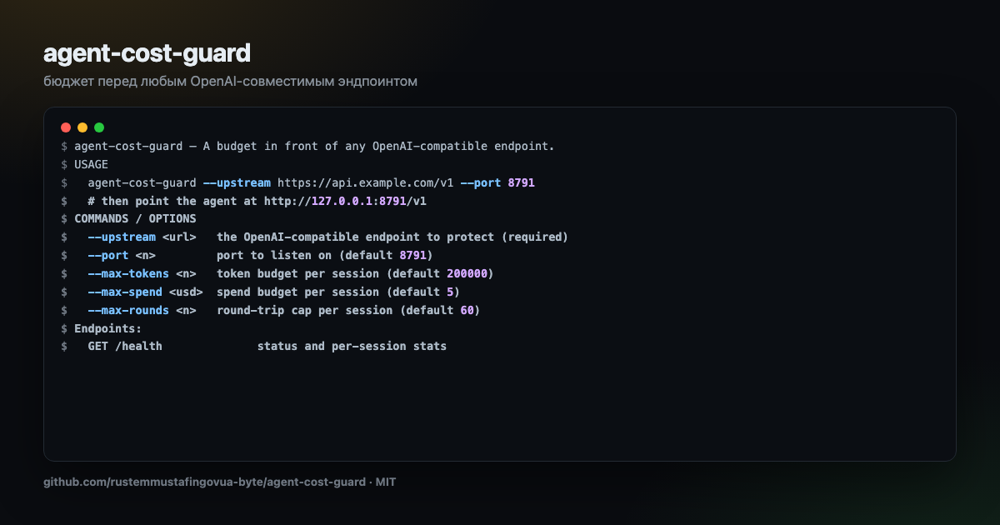

<div align="center">



# agent-cost-guard

**A budget in front of any OpenAI-compatible endpoint.**

[](https://github.com/rustemmustafingovua-byte/agent-cost-guard/actions/workflows/ci.yml)
[](https://www.npmjs.com/package/agent-cost-guard)
[](./LICENSE)
[](https://nodejs.org)
[](https://base.org)

[**Docs**](https://rustemmustafingovua-byte.github.io/agent-cost-guard/) · [Issues](https://github.com/rustemmustafingovua-byte/agent-cost-guard/issues) · [Discussions](https://github.com/rustemmustafingovua-byte/agent-cost-guard/discussions)

</div>

---

An agent loop is unbounded by nature: it retries, it re-reads files, it calls tools in circles. agent-cost-guard is a proxy that puts a wall around it — token budget, spend budget, round-trip cap, latency ceiling — in front of any OpenAI-compatible endpoint.

## Install

```bash
npm i -g agent-cost-guard
```

<details>
<summary>Без npm-логина — из tarball релиза</summary>

```bash
npm i -g https://github.com/rustemmustafingovua-byte/agent-cost-guard/releases/download/v0.1.0/agent-cost-guard-0.1.0.tgz
```

</details>
## What it does

| | |
|---|---|
| **Token budget per session** | a long context cannot run away |
| **Spend budget per session** | priced per model, in USD |
| **Round-trip cap** | stops tool-call storms |
| **A report of where it went** | per model, per session, at /report |


## Usage

```bash
agent-cost-guard --upstream https://api.example.com/v1 --port 8791
# then point the agent at http://127.0.0.1:8791/v1
```

## CLI

```
agent-cost-guard — A budget in front of any OpenAI-compatible endpoint.

USAGE
  agent-cost-guard --upstream https://api.example.com/v1 --port 8791
  # then point the agent at http://127.0.0.1:8791/v1

COMMANDS / OPTIONS
  --upstream <url>   the OpenAI-compatible endpoint to protect (required)
  --port <n>         port to listen on (default 8791)
  --max-tokens <n>   token budget per session (default 200000)
  --max-spend <usd>  spend budget per session (default 5)
  --max-rounds <n>   round-trip cap per session (default 60)

Endpoints:
  GET /health              status and per-session stats
  GET /report?id=<session>  the spend report of one session

Give the agent a session id: header  x-session-id: <id>

MIT · https://github.com/rustemmustafingovua-byte
```

## Part of a portfolio

| Project | What it does |
|---|---|
| [`opencode-free-stack`](https://github.com/rustemmustafingovua-byte/opencode-free-stack) | route to free models, fall back automatically |
| [`free-web-mcp`](https://github.com/rustemmustafingovua-byte/free-web-mcp) | web search for agents, zero credits |
| [`agent-x402`](https://github.com/rustemmustafingovua-byte/agent-x402) | pay per API call in USDC with a spend policy |

## Donate

MIT, forever. USDC on Base:

```
0x8aC6a229f254980CCd3Dd35CF5E1B7c08880B40E
```

## License

MIT © rustemmustafingovua-byte
